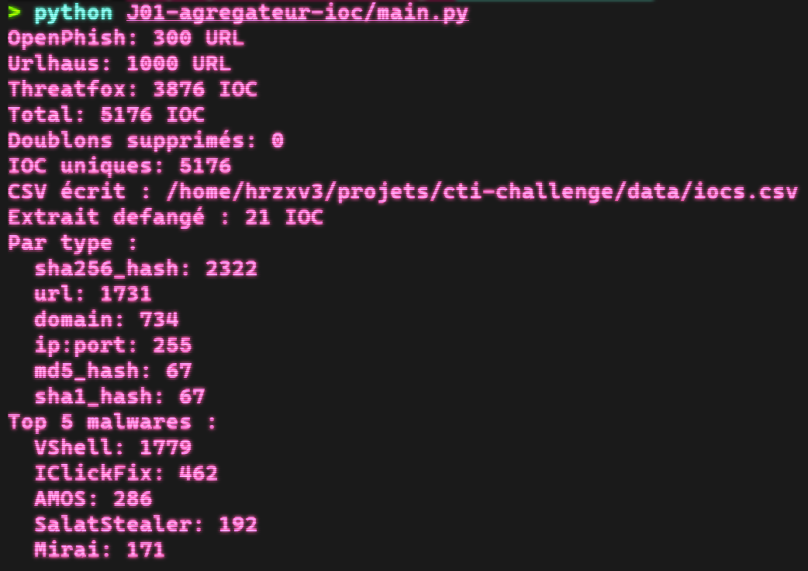

# J01 - Agrégateur d'IOC

> Défi CTI - jour 1/25 - 26/10/2026 - Collecte, Python, API

Script Python qui collecte les IOC récents de trois sources publiques (OpenPhish, URLhaus, ThreatFox), les met au même format, supprime les doublons et les exporte dans un CSV. C'est la première brique du défi : ce CSV sera enrichi, visualisé puis importé dans OpenCTI les jours suivants.



## Résultat du 26/10/2026

| Source | IOC collectés |
|---|---|
| OpenPhish | 300 URL |
| URLhaus | 1000 URL |
| ThreatFox | 3876 IOC |
| **Total** | **5176 IOC uniques** |

| Type d'IOC | Nombre |
|---|---|
| sha256_hash | 2322 |
| url | 1731 |
| domain | 734 |
| ip:port | 255 |
| md5_hash | 67 |
| sha1_hash | 67 |

Top 5 des familles de malware : VShell (1779), IClickFix (462), AMOS (286), SalatStealer (192), Mirai (171).

## Démarche

1. Une fonction par source. OpenPhish renvoie du texte brut (une URL par ligne), URLhaus et ThreatFox renvoient du JSON via l'API abuse.ch, avec une clé stockée dans `.env`.
2. Normalisation : chaque IOC devient une fiche avec les mêmes colonnes (`ioc`, `type`, `source`, `malware`, `first_seen`, `tags`), quelle que soit la source.
3. Dédoublonnage sur la valeur de l'IOC.
4. Export complet dans `data/iocs.csv` (non versionné, car il contient des URL actives) et d'un extrait defangé dans [`data/iocs_sample.csv`](../data/iocs_sample.csv).
5. Statistiques par type d'IOC et par famille de malware, en excluant les valeurs non informatives.

## Observations

- Plusieurs sous-domaines de `agenpr[.]org` servent des URL liées à Vidar : une même infrastructure, piste de pivot pour J02.
- Les échantillons AMOS sont tagués ClickFix : le stealer macOS est diffusé via de faux captchas.
- URLhaus remonte surtout des charges Mozi et Mirai sur des IP aux ports élevés : propagation de botnets IoT.
- Des pages de phishing sont hébergées sur des services légitimes (Firebase Cloud Workstations, Weebly) et imitent Roblox ou Xfinity.

## Lancer le projet

```bash
# depuis la racine du repo, venv activé, ABUSECH_API_KEY renseignée dans .env
python J01-agregateur-ioc/main.py
```

## Limites

- Flux gratuits et partiels : OpenPhish est limité à 300 URL, URLhaus aux 1000 dernières.
- Dédoublonnage strict : `https://site.com/` et `https://site.com` comptent comme deux IOC.
- URLhaus ne fournit pas la famille de malware dans un champ dédié (elle apparaît parfois dans les tags) : la colonne `malware` est vide pour cette source.
- La valeur `Unknown malware` de ThreatFox est exclue des statistiques.
- Pas de score de confiance ni de suivi dans le temps : une collecte est une photo à un instant donné.

## Pistes

- Normaliser les URL avant le dédoublonnage.
- Garder un historique des collectes pour suivre l'évolution jour après jour.
- Ajouter le niveau de confiance fourni par ThreatFox.
