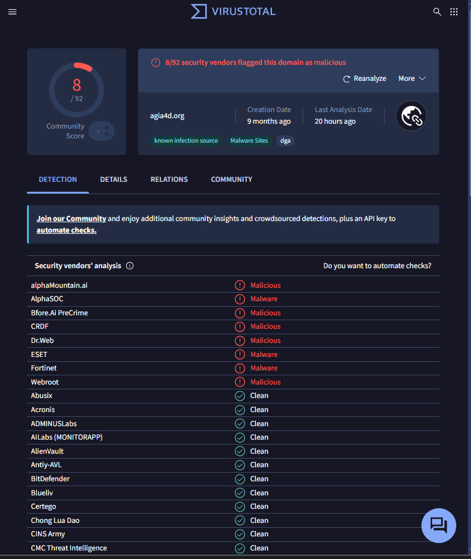
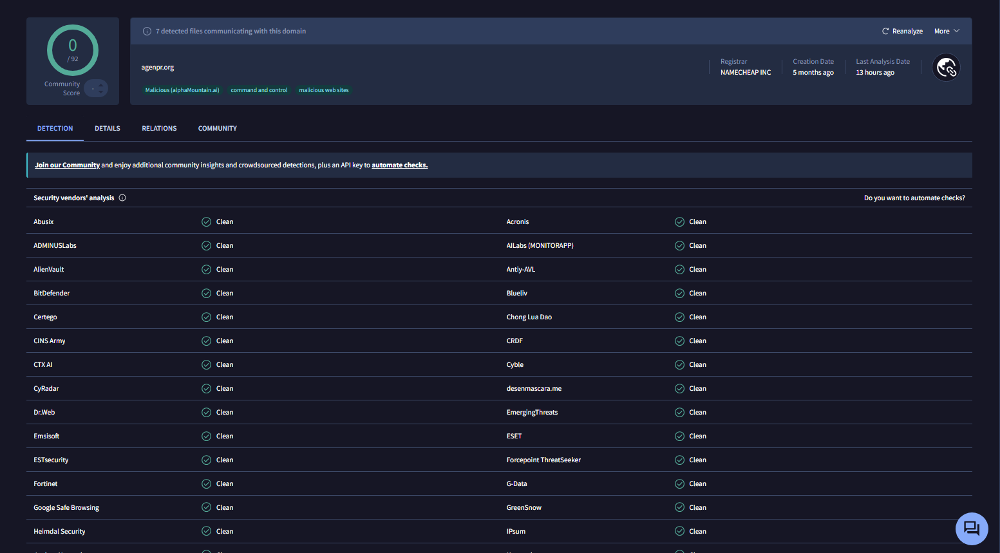
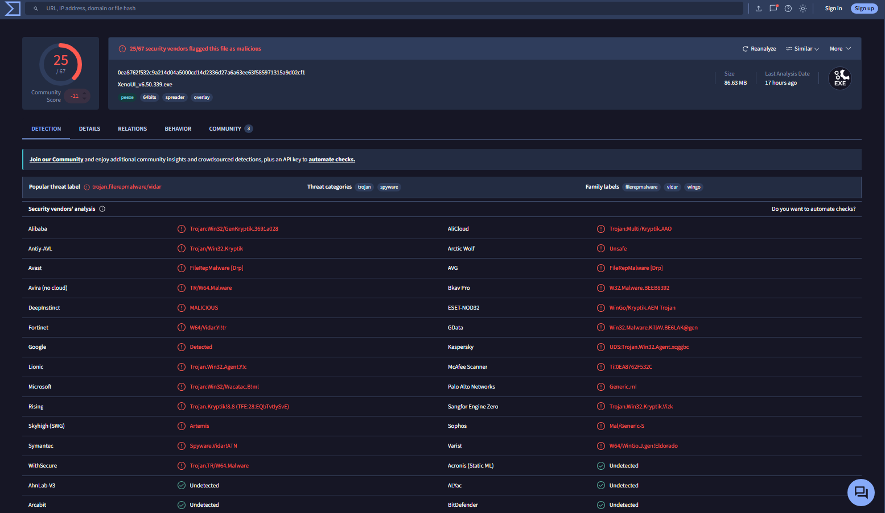

# J02 - Pivot sur une infrastructure de C2 Vidar

> Défi CTI - jour 2/25 - 27/10/2026 - Investigation infra, DNS, whois, certificats

À partir de la collecte de J01, six domaines au même profil remontaient tous comme C2 de Vidar sur ThreatFox. L'objectif était de vérifier, uniquement en sources ouvertes et de façon passive, s'ils appartenaient à une même infrastructure. Résultat : quatre indices techniques indépendants de ThreatFox relient ces domaines, et un échantillon de Vidar déguisé en outil de triche Roblox contacte l'un d'eux.

> Investigation passive uniquement : aucun site n'a été visité, aucun fichier téléchargé. Les domaines sont defangés.

## Point de départ

| Élément | Détail |
|---|---|
| Données | collecte J01 du 27/10/2026 : 3027 IOC uniques, Vidar en tête (360 IOC) |
| Indicateurs | 6 domaines, 324 URL de C2 Vidar |
| Outils | dig, whois, RDAP, crt.sh, API ThreatFox, VirusTotal, jq |

| Domaine | URL Vidar (ThreatFox) |
|---|---|
| agitawin[.]org | 95 |
| agia4d[.]org | 95 |
| agenpr[.]org | 55 |
| agng11[.]org | 39 |
| ayu99[.]pro | 36 |
| bala7[.]org | 4 |

## 1. Repérage dans la collecte

Les domaines qui reviennent le plus dans la collecte, une fois écartées les plateformes légitimes (GitHub, pages.dev, Vercel, Blogspot), forment un groupe au même motif : préfixe `ag`, extension `.org`, sous-domaines de 1 à 3 caractères (`mv.`, `x.`, `he1.`) et chemins aléatoires (`/zf/`, `/a7/`).

Presque chaque sous-domaine compte exactement 11 ou 12 URL, une régularité qui indique une génération ou un signalement automatisé.

## 2. DNS : Cloudflare partout

Les 6 domaines résolvent vers des IP Cloudflare (`104.21.x.x`, `172.67.x.x`, `188.114.96-97.x`). Le partage d'IP ne prouve rien ici : ces adresses sont partagées par des milliers de sites. Cloudflare masque les vrais serveurs, et le pivot par IP s'arrête là.

Les serveurs de noms, en revanche, sont identiques sur les 6 domaines :

```
brady.ns.cloudflare.com
princess.ns.cloudflare.com
```

Cloudflare attribue une paire de serveurs de noms par compte. La même paire peut être partagée par des comptes sans lien, donc l'indice seul est faible, mais il est cohérent avec un même compte Cloudflare.

## 3. Whois et RDAP

| Domaine | Création | Registrar | Durée |
|---|---|---|---|
| ayu99[.]pro | 01/11/2024 | Namecheap | 2 ans (expire le 01/11/2026) |
| agia4d[.]org | 08/01/2026 | Namecheap | 1 an |
| agitawin[.]org | 27/02/2026 | Namecheap | 1 an |
| agng11[.]org | 02/05/2026 | Namecheap | 1 an |
| agenpr[.]org | 13/05/2026 | Namecheap | 1 an |
| bala7[.]org | 18/05/2026 | Namecheap | 1 an |

Même registrar pour les 6 domaines, enregistrements courts, avec une vague de trois créations en 16 jours en mai 2026. Namecheap est très répandu : l'indice seul est faible.

## 4. Certificats (crt.sh)

Sur les 6 domaines, crt.sh ne montre que des certificats wildcard (`*.domaine`), et le premier certificat date du jour même de la création du domaine.

| Domaine | Création | 1er certificat |
|---|---|---|
| ayu99[.]pro | 01/11/2024 | 01/11/2024 |
| agia4d[.]org | 08/01/2026 | 08/01/2026 |
| agitawin[.]org | 27/02/2026 | 27/02/2026 |
| agng11[.]org | 02/05/2026 | 02/05/2026 |
| agenpr[.]org | 13/05/2026 | 13/05/2026 |
| bala7[.]org | 18/05/2026 | 18/05/2026 |

Le mode opératoire est donc identique partout : achat chez Namecheap, passage sur Cloudflare et certificat wildcard le jour même. Le wildcard permet de créer à volonté des sous-domaines jetables sans demander de nouveau certificat, ce qui explique l'absence de sous-domaines nommés dans crt.sh.

## 5. Rôle et chronologie (ThreatFox)

Une URL de chaque domaine, interrogée sur l'API ThreatFox :

| Signalée le (UTC) | URL | Type |
|---|---|---|
| 26/10 21:00:48 | hxxps://qtr.agenpr[.]org/cb/ | botnet_cc |
| 27/10 06:00:48 | hxxps://x.agia4d[.]org/zw/ | botnet_cc |
| 27/10 10:00:48 | hxxps://zy.agitawin[.]org/xh/ | botnet_cc |
| 27/10 14:00:48 | hxxps://v.ayu99[.]pro/d/ | botnet_cc |
| 27/10 17:50:48 | hxxps://mv.agng11[.]org/d7/ | botnet_cc |
| 27/10 18:40:48 | hxxps://i.bala7[.]org/z/ | botnet_cc |

- Toutes les URL sont classées `botnet_cc` (C2), avec une confiance de 100.
- Elles sont toutes signalées par le même chercheur (`crep1x`), toujours à `:48` secondes sur des minutes multiples de 5 : un outil de suivi automatisé relève une nouvelle URL toutes les 5 minutes.
- Avec 11 à 12 URL par sous-domaine, chaque sous-domaine semble rester actif environ une heure.
- Les 6 domaines ont tous eu une URL active dans les mêmes 24 heures : il s'agit d'un groupe de domaines utilisés en parallèle, à tour de rôle, et non d'un domaine remplacé par un autre.

## 6. VirusTotal





| Domaine | Détections | Catégories |
|---|---|---|
| agia4d[.]org | 8/92 | known infection source, Malware Sites, tag `dga` |
| agenpr[.]org | 0/92 | command and control (Sophos), malicious web sites |
| bala7[.]org | 0/92 | command and control (Sophos) |
| ayu99[.]pro | 0/92 | command and control (Sophos), Phishing |
| agitawin[.]org | 0/92 | aucune |
| agng11[.]org | 0/92 | aucune catégorie de sécurité |

Cinq domaines sur six n'ont aucune détection, alors que ThreatFox liste plus de 300 URL de C2 actives. Un filtrage basé sur le seul score VirusTotal laisserait passer cette infrastructure.

## 7. Du leurre au C2

VirusTotal référence 7 fichiers malveillants qui communiquent avec agenpr[.]org, analysés les 26 et 27/10/2026 :

| Fichier | Détection |
|---|---|
| XenoUI_v6.50.339.exe | 25/67 |
| v6.50.339.zip | 14/58 |
| LunaUI_v2.61.713... | 17/48 |
| Setup.exe (2 fichiers) | 10/60, 12/70 |
| 2 fichiers renommés en hash | 18/69, 33/70 |

Xeno et Luna sont des noms d'« executors » Roblox, des outils de triche. Les échantillons se font passer pour ces outils.



`XenoUI_v6.50.339.exe` est identifié comme Vidar par plusieurs moteurs (Fortinet `W64/Vidar.Y!tr`, Symantec `Spyware.Vidar!ATN`, étiquette de famille `vidar`). Le fichier pèse 86,63 Mo, avec le tag `overlay` : il a été gonflé artificiellement pour dépasser les limites de taille de certains antivirus et sandbox. Plusieurs moteurs le classent comme binaire écrit en Go (`WinGo`).

## Synthèse

```
Leurre : faux outil de triche Roblox (XenoUI, LunaUI)
   |
   v
Vidar (SHA-256 0ea8762f...a9d02cf1)
   |  contacte
   v
agenpr[.]org  ----+
                  |  mêmes NS Cloudflare (brady + princess)
agia4d[.]org  ----+  même registrar (Namecheap)
agitawin[.]org ---+  même montage (wildcard le jour de la création)
agng11[.]org  ----+  tous botnet_cc Vidar (ThreatFox)
bala7[.]org   ----+  actifs dans les mêmes 24 h
ayu99[.]pro   ----+
```

## IOC

| Type | Valeur |
|---|---|
| Domaine | agitawin[.]org |
| Domaine | agia4d[.]org |
| Domaine | agenpr[.]org |
| Domaine | agng11[.]org |
| Domaine | bala7[.]org |
| Domaine | ayu99[.]pro |
| SHA-256 | 0ea8762f532c9a214d04a5000cd14d2336d27a6a63ee63f585971315a9d02cf1 (XenoUI_v6.50.339.exe) |
| Serveurs de noms | brady.ns.cloudflare.com + princess.ns.cloudflare.com (indice de regroupement, pas un IOC à bloquer) |

## MITRE ATT&CK

| Technique | Observation |
|---|---|
| T1583.001 - Acquire Infrastructure: Domains | 6 domaines achetés chez Namecheap entre 2024 et 2026 |
| T1071.001 - Application Layer Protocol: Web Protocols | C2 en HTTPS derrière Cloudflare |
| T1568 - Dynamic Resolution | rotation des domaines et sous-domaines jetables (hypothèse) |
| T1036 - Masquerading | échantillons déguisés en outils de triche Roblox |
| T1204.002 - User Execution: Malicious File | exécution par la victime du faux outil (déduit du leurre) |
| T1027.001 - Binary Padding | exécutable gonflé à 86 Mo |

## Conclusion et niveau de confiance

| Affirmation | Confiance | Pourquoi |
|---|---|---|
| Les 5 domaines `.org` appartiennent à une même infrastructure | Élevée | NS, registrar, montage des certificats, rôle et période d'activité identiques |
| ayu99[.]pro en fait partie | Moyenne à élevée | même montage et même rôle, mais plus ancien et nom différent |
| Ces domaines servent de C2 à Vidar | Élevée | ThreatFox, Sophos et un échantillon Vidar qui contacte agenpr[.]org |
| La campagne cible des joueurs de Roblox | Moyenne | déduit des seuls noms de fichiers |
| Rotation programmée des domaines | Faible | 6 observations, cadence possiblement liée à l'outil de suivi |

## Limites

- Les URL de C2 viennent d'un seul signaleur sur ThreatFox. Le lien entre les domaines repose en revanche sur des indices indépendants (DNS, whois, certificats, VirusTotal).
- Les heures de la section 5 sont celles d'une URL par domaine, pas la première apparition de chaque domaine.
- Cloudflare masque les vrais serveurs : l'hébergement réel n'a pas été identifié.
- Seuls les fichiers liés à agenpr[.]org ont été examinés.
- Les détections VirusTotal concernent les domaines principaux, pas chaque sous-domaine.
- Aucune analyse dynamique de l'échantillon (prévue plus tard dans le défi).

## Pistes

- Examiner les fichiers qui communiquent avec les 5 autres domaines.
- Suivre l'apparition de nouveaux domaines au même profil (Namecheap, mêmes NS, wildcard).
- Vérifier si ayu99[.]pro est renouvelé après son expiration du 01/11/2026.
