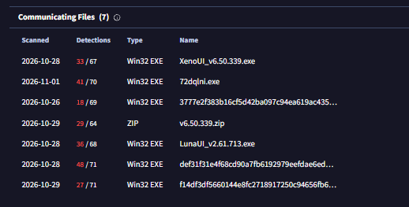
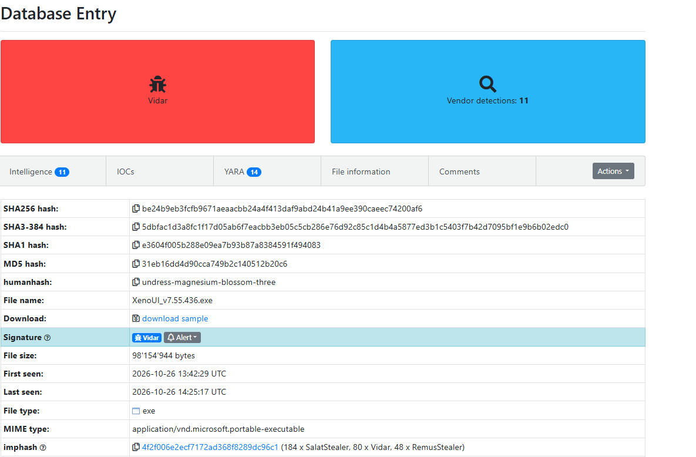
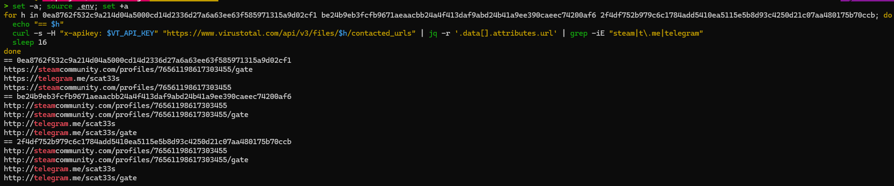
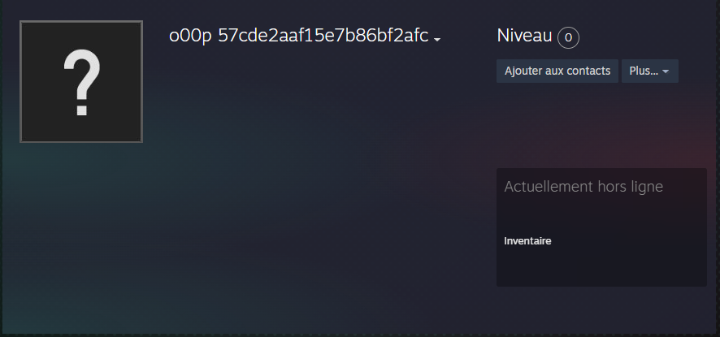
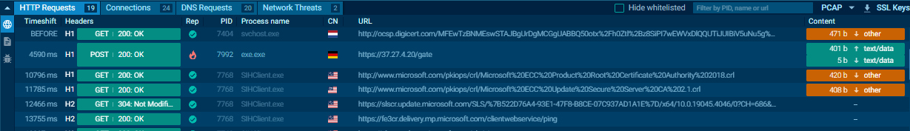
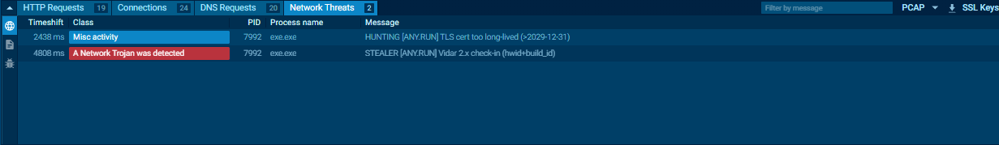

# J03 - Enquête : de faux outils Roblox au profil Steam d'un opérateur Vidar

> Défi CTI - jour 3/25 - 29/10/2026 - Investigation, analyse de malware, renseignement

En J02, six domaines de C2 du stealer Vidar formaient une même infrastructure. Cette enquête remonte la chaîne dans l'autre sens : des fichiers qui contactent ces serveurs jusqu'à l'opérateur qui les pilote. Trois versions de faux outils de triche Roblox lisent le même profil Steam et la même chaîne Telegram, où l'opérateur publie l'adresse de ses serveurs. Le pseudo de ce profil change toutes les quelques minutes : c'est la rotation de C2 observée en J02, vue de l'intérieur.

> Investigation passive uniquement : aucun échantillon n'a été téléchargé ni exécuté. Les observations dynamiques proviennent des sandboxes publiques de VirusTotal et d'ANY.RUN. Les IOC sont defangés.

## Point de départ

| Élément | Détail |
|---|---|
| Question | qui pilote l'infrastructure de C2 de J02, et les faux outils Roblox viennent-ils tous du même opérateur ? |
| Données de départ | 7 fichiers qui contactent agenpr[.]org (VirusTotal), dont XenoUI_v6.50.339.exe |
| Sources | API VirusTotal, MalwareBazaar, ANY.RUN, ThreatFox, urlscan, whois |
| Outils | curl, jq, whois |

## 1. Les fichiers qui contactent l'infrastructure de J02



VirusTotal référence 7 fichiers qui contactent agenpr[.]org, l'un des domaines de C2 de J02 :

| SHA-256 | Nom | Détections 27/10 | Détections 29/10 |
|---|---|---|---|
| 0ea8762f532c9a214d04a5000cd14d2336d27a6a63ee63f585971315a9d02cf1 | XenoUI_v6.50.339.exe | 25 | 33 |
| 3168dcce1d55a1cc748349c44eebd15d374160f577463fb7c31e2722db2c00d0 | renommé en hash | - | 36 |
| 3777e2f383b16cf5d42ba097c94ea619ac43556db27f29ef2e9d720743e37537 | inconnu | 18 | 18 |
| 498b18d7f21426e5ebc78af1ecca1d42f8862cb22dfae0ec8bc9c47e8c4d0654 | v6.50.339.zip | 14 | 29 |
| a17fd5070218c7ff79141c7bbbe1f6c49cfe4cf65cc2d2bb899f192dcca08c60 | LunaUI_v2.61.713.exe | 17 | 36 |
| def31f31e4f68cd90a7fb6192979eefdae6eddeabaeaa72c1a7acd15d68e3816 | inconnu | 33 | 48 |
| f14df3df5660144e8fc2718917250c94656fb61714549216df9ae9b2bada0a14 | renommé en hash | - | 27 |

Au 01/11/2026, la liste contient un nouveau nom, `72dqlni.exe` (41/70 détections), analysé ce jour-là.

Les détections augmentent fortement en 48 heures. Pendant les premiers jours, la majorité des antivirus laissaient passer ces fichiers : c'est la fenêtre pendant laquelle les victimes sont infectées.

Xeno et Luna sont des noms d'« executors » Roblox, des outils de triche. Les échantillons se font passer pour eux.

## 2. De nouvelles versions de la campagne



Aucun de ces 7 fichiers n'est disponible sur MalwareBazaar. En revanche, la recherche des échantillons récents classés Vidar fait apparaître des versions plus récentes des mêmes leurres :

| SHA-256 | Nom | Taille | Soumis le |
|---|---|---|---|
| be24b9eb3fcfb9671aeaacbb24a4f413daf9abd24b41a9ee390caeec74200af6 | XenoUI_v7.55.436.exe | 98 Mo | 26/10/2026 |
| 2f4df752b979c6c1784add5410ea5115e5b8d93c4250d21c07aa480175b70ccb | LunaUI_v8.32.364.exe | 98 Mo | 26/10/2026 |

Observations sur les échantillons Vidar récents de MalwareBazaar :
- la plupart font 3 à 7 Mo, mais les faux outils Roblox approchent les 100 Mo : ils sont gonflés artificiellement pour dépasser les limites de taille de certains antivirus et sandbox, comme le XenoUI de 86 Mo de J02 ;
- XenoUI v7.55 partage son **imphash** (`4f2f006e2ecf7172ad368f8289dc96c1`, une empreinte des fonctions Windows importées par l'exécutable) avec 184 échantillons de SalatStealer, 80 de Vidar et 48 de RemusStealer sur MalwareBazaar. Un même imphash sur plusieurs familles indique en général un outil commun d'emballage (packer ou crypter) plutôt qu'un même malware ;
- certains noms de fichiers mélangent des lettres cyrilliques qui imitent des lettres latines (gitlосitу64-v.2.774.exe, Sеt_Uр [UРD].exe), pour contourner les filtres sur les noms de fichiers.

## 3. Même leurre, même opérateur ?

Le nom XenoUI ne prouve rien : n'importe qui peut l'utiliser comme leurre, et Vidar est loué à de nombreux clients, qui le diffusent chacun de leur côté. Il fallait une preuve technique.

### Démarche

Les sandboxes de VirusTotal enregistrent les adresses contactées par chaque fichier. Les domaines contactés par XenoUI v7.55 ne contiennent aucun domaine de J02, mais deux sites ressortent du bruit normal de Windows : **steamcommunity[.]com** et **telegram[.]me**.

C'est la signature d'une technique connue de Vidar, le **dead drop resolver** (ATT&CK T1102.001). Le malware ne contient pas forcément l'adresse de son C2 : il va lire un profil Steam ou une chaîne Telegram créés par l'opérateur, qui y écrit l'adresse du serveur du moment. Le domaine seul ne distingue pas les opérateurs, puisque tous les Vidar l'utilisent. C'est **le compte précis** qui identifie l'opérateur.

URL complètes contactées par les trois versions :

```bash
for h in 0ea8762f532c9a214d04a5000cd14d2336d27a6a63ee63f585971315a9d02cf1 be24b9eb3fcfb9671aeaacbb24a4f413daf9abd24b41a9ee390caeec74200af6 2f4df752b979c6c1784add5410ea5115e5b8d93c4250d21c07aa480175b70ccb; do
  echo "== $h"
  curl -s -H "x-apikey: $VT_API_KEY" "https://www.virustotal.com/api/v3/files/$h/contacted_urls" | jq -r '.data[].attributes.url' | grep -iE "steam|t\.me|telegram"
  sleep 16
done
```



### Résultat

| | XenoUI v6.50 (J02) | XenoUI v7.55 | LunaUI v8.32 |
|---|---|---|---|
| Profil Steam | steamcommunity[.]com/profiles/76561198617303455 | identique | identique |
| Chaîne Telegram | telegram[.]me/scat33s | identique | identique |

Les trois versions lisent les mêmes comptes. Un autre client de Vidar n'aurait aucune raison d'utiliser ceux-ci : il s'agit du **même opérateur**. Chaque client configurant ses propres comptes, c'est très probablement un client du service Vidar, et non son développeur.

## 4. Le profil Steam : la boîte aux lettres de l'opérateur



Le pseudo du profil n'est pas un vrai pseudo : c'est le message que Vidar vient lire. Steam conserve l'historique des pseudos du compte (relevé le 29/10/2026 vers 17 h) :

```
o00p 428aaea7f8597186bf2afcef87   (pseudo le 29/10 à ~17 h)
o00p 428aaea7f8597186bf2afcef9b
o00p 428aaea7f8597186bf2afcef9c
o00p 428aaea7f8597186bf2afc
o00p 5ecde2a4f71b2786bf2afcef97
o00p 5ecde2a4f71b2786bf2afcef85
o00p 5ecde2a4f71b2786bf2afcef86
o00p 5ecde2a4f71b2786bf2afcef98
o00p 5ecde2a4f71b2786bf2afcef88
o00p 5ecde2a4f71b2786bf2afcef93
```

Hypothèse : `o00p` sert de marqueur, et la suite est l'adresse du C2 encodée. Toutes les valeurs se terminent par `bf2afcef..`, ce qui pourrait correspondre à une partie commune en clair (la même extension de domaine, par exemple). Non vérifié : il faudrait retrouver la méthode d'encodage dans le code de Vidar.

**Rotation observée en direct :**

| Date et heure (Paris) | Source | Pseudo |
|---|---|---|
| 29/10, ~16:59 | capture d'écran | o00p 428aaea7f8597186bf2afcef87 |
| 29/10, 17:10 | [scan urlscan](https://urlscan.io/result/01a1886d-59b6-716a-9026-7ea3d360aa3f/) | o00p 428aaea7f8597186bf2afcef9b |
| 01/11, soir | capture d'écran | o00p 57cde2aaf15e7b86bf2afc |

Le pseudo change en une dizaine de minutes, et réutilise des valeurs déjà présentes dans l'historique. Trois jours plus tard, le profil est toujours actif, avec une nouvelle valeur qui se termine elle aussi par `bf2afc`. C'est la rotation de C2 observée en J02 : l'opérateur modifie son profil, et tous les malwares déjà installés suivent, sans nouvelle version.

## 5. Le C2 vu en action (ANY.RUN)





Analyse publique de XenoUI v7.55 sur ANY.RUN (26/10/2026, 17:45, Windows 10 64 bits, verdict « Malicious activity », tags stealer et vidar) :

| Temps | Observation |
|---|---|
| 2,4 s | alerte « TLS cert too long-lived (>2029-12-31) » : certificat HTTPS valable au-delà de 2029, anormal pour un vrai site, typique d'un certificat fabriqué par l'attaquant |
| 4,6 s | POST hxxps://37.27.4[.]20/gate (401 octets envoyés, réponse 200) : prise de contact avec le C2, serveur actif |
| 4,8 s | alerte « STEALER Vidar 2.x check-in (hwid+build_id) » : Vidar version 2 s'annonce avec l'identifiant de la machine infectée (hwid) et l'identifiant de son build (build_id) |

| | 37.27.4[.]20 |
|---|---|
| Hébergeur | Hetzner Cloud, centre de données d'Helsinki (Finlande) |
| ThreatFox | botnet_cc Vidar, signalé le 26/10/2026 à 08:24 UTC |

Le `build_id` identifie la version générée par le client de Vidar : le récupérer dans la configuration permettrait de rattacher d'autres échantillons au même opérateur.

Dans cette analyse, aucune requête vers Steam ni Telegram : le C2 a répondu directement. Hypothèse : Vidar contacte d'abord un C2 inscrit en dur, et ne lit ses comptes Steam et Telegram qu'en secours. Contrairement aux domaines de J02, cachés derrière Cloudflare, ce serveur est directement exposé chez un hébergeur identifié.

## Synthèse

```
1. La victime télécharge un faux outil de triche Roblox (XenoUI, LunaUI)
                        |
2. Vidar s'exécute : fichier gonflé à ~100 Mo pour échapper aux analyses
                        |
3. Il contacte son C2 (37.27.4[.]20) ou, en secours,
   lit le profil Steam / la chaîne Telegram de l'opérateur
                        |
4. Il y trouve l'adresse du C2 du moment (domaines de J02 en rotation)
                        |
5. Il envoie les mots de passe, cookies et portefeuilles volés
```

## IOC

| Type | Valeur | Rôle |
|---|---|---|
| SHA-256 | 0ea8762f532c9a214d04a5000cd14d2336d27a6a63ee63f585971315a9d02cf1 | XenoUI_v6.50.339.exe |
| SHA-256 | be24b9eb3fcfb9671aeaacbb24a4f413daf9abd24b41a9ee390caeec74200af6 | XenoUI_v7.55.436.exe |
| SHA-256 | 2f4df752b979c6c1784add5410ea5115e5b8d93c4250d21c07aa480175b70ccb | LunaUI_v8.32.364.exe |
| SHA-256 | a17fd5070218c7ff79141c7bbbe1f6c49cfe4cf65cc2d2bb899f192dcca08c60 | LunaUI_v2.61.713.exe |
| URL | steamcommunity[.]com/profiles/76561198617303455 | dead drop resolver |
| URL | telegram[.]me/scat33s | dead drop resolver |
| IP | 37.27.4[.]20 | C2 |

## MITRE ATT&CK

| Technique | Observation |
|---|---|
| T1583.006 - Acquire Infrastructure: Web Services | profil Steam et chaîne Telegram créés pour diffuser l'adresse du C2 |
| T1102.001 - Web Service: Dead Drop Resolver | Vidar lit l'adresse de son C2 dans ces comptes |
| T1071.001 - Application Layer Protocol: Web Protocols | C2 en HTTPS (POST /gate) |
| T1036 - Masquerading | faux outils de triche Roblox, noms de fichiers avec des lettres cyrilliques |
| T1027.001 - Binary Padding | exécutables gonflés à près de 100 Mo |
| T1204.002 - User Execution: Malicious File | exécution par la victime du faux outil |

## Niveau de confiance

| Affirmation | Confiance | Pourquoi |
|---|---|---|
| XenoUI v6.50, XenoUI v7.55 et LunaUI v8.32 viennent du même opérateur | Élevée | mêmes comptes Steam et Telegram, propres à un opérateur |
| Ces comptes distribuent les domaines de C2 de J02 | Élevée | XenoUI v6.50 contacte agenpr[.]org et lit ces comptes |
| L'opérateur est un client de Vidar, pas son développeur | Moyenne à élevée | déduit du fonctionnement connu du service |
| Le pseudo Steam contient l'adresse du C2 encodée | Moyenne | cohérent avec la rotation observée, encodage non vérifié |
| C2 en dur prioritaire, comptes Steam et Telegram en secours | Faible | deux sandboxes, deux comportements différents |

## Limites

- Aucun échantillon n'a été exécuté personnellement : les observations dynamiques viennent de VirusTotal et d'ANY.RUN.
- Les 7 fichiers liés à agenpr[.]org ne sont pas téléchargeables gratuitement : l'analyse s'appuie sur des versions plus récentes des mêmes leurres.
- L'encodage du pseudo Steam n'a pas été décodé.
- Le scan urlscan du profil a été lancé en mode public, donc visible par tous.

## Pistes

- Écrire des règles YARA pour la famille Vidar à partir des échantillons, dans une VM isolée (reporté plus tard dans le défi).
- Retrouver l'encodage du pseudo Steam dans le code de Vidar (J08, fiche Vidar).
- Extraire le build_id de la configuration de Vidar pour rattacher d'autres échantillons à cet opérateur.
- Rechercher d'autres serveurs du même opérateur à partir du certificat TLS de 37.27.4[.]20 (J12, chasse aux C2).
- Signaler le profil Steam à Valve et la chaîne Telegram à Telegram : sans ces comptes, les malwares déjà installés ne retrouvent plus leur C2.

## Sources

- [VirusTotal](https://www.virustotal.com)
- [MalwareBazaar](https://bazaar.abuse.ch)
- [ANY.RUN](https://app.any.run)
- [ThreatFox](https://threatfox.abuse.ch)
- [urlscan.io](https://urlscan.io)
- [MITRE ATT&CK - T1102.001](https://attack.mitre.org/techniques/T1102/001/)
