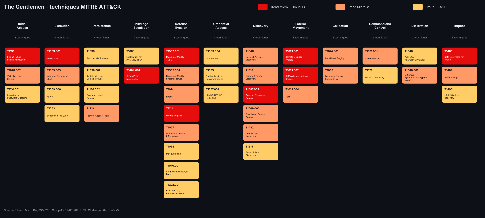

# J04 - Fiche acteur : The Gentlemen

> Défi CTI - jour 4/25 - 29/10/2026 - Renseignement, victimologie, ATT&CK

The Gentlemen est le groupe de ransomware qui a revendiqué le plus de victimes françaises depuis mai 2026. Apparu en 2025, il fonctionne en ransomware-as-a-service, entre surtout par des équipements Fortinet vulnérables et frappe tous les secteurs. Cette fiche croise les revendications publiques (ransomware.live) avec les rapports de Trend Micro et de Group-IB.

> Fiche réalisée uniquement à partir de sources ouvertes. Les victimes ne sont pas nommées : seules des statistiques agrégées sont présentées.

## Point de départ

| Élément | Détail |
|---|---|
| Question | quel groupe de ransomware vise le plus la France en ce moment, et comment opère-t-il ? |
| Données | API ransomware.live : 712 victimes françaises recensées (2017-2026), 1006 victimes de The Gentlemen dans le monde |
| Rapports | Trend Micro (09/09/2025), Group-IB (19/03/2026) |
| Outils | curl, jq, MITRE ATT&CK Navigator |

## 1. Choix du groupe

Groupes ayant revendiqué le plus de victimes françaises depuis le 01/05/2026 :

| Groupe | Victimes en France |
|---|---|
| **The Gentlemen** | **24** |
| Qilin | 21 |
| Krybit | 9 |
| ZaWoo, LockBit 5 | 6 |
| Panzer, MedusaLocker | 4 |

The Gentlemen arrive en tête, juste devant Qilin, le groupe auquel son administrateur était auparavant affilié (voir section 2).

## 2. Identité

| | |
|---|---|
| Apparition | 2025 (premières victimes françaises en septembre 2025) |
| Modèle | ransomware-as-a-service (RaaS), environ 20 membres selon Group-IB |
| Administrateur | acteur russophone connu sous le pseudonyme *hastalamuerte*, ancien affilié de Qilin sous le nom « ArmCorp » (Group-IB) |
| Extorsion | double extorsion : vol de données puis chiffrement |
| Plateformes chiffrées | Windows, Linux, VMware ESXi |
| Marqueurs | extension `.7mtzhh`, note de rançon `README-GENTLEMEN.txt` (Trend Micro) |

L'administrateur fournit à ses affiliés des accès à des équipements déjà compromis, des outils pour neutraliser les antivirus et EDR, et des scripts prêts à l'emploi.

## 3. Victimologie

### Dans le monde

1006 victimes revendiquées en environ 14 mois, soit environ 70 par mois.

| Pays | Victimes | Part |
|---|---|---|
| États-Unis | 203 | 20 % |
| Royaume-Uni | 45 | 4,5 % |
| Thaïlande | 44 | 4,4 % |
| **France** | **41** | **4,1 %** |
| Allemagne | 41 | 4,1 % |
| Brésil | 38 | 3,8 % |
| Italie | 36 | 3,6 % |
| Inde | 36 | 3,6 % |
| Canada | 27 | 2,7 % |

La France n'est pas une cible privilégiée : elle se situe au même niveau que l'Allemagne. La présence de la Thaïlande en 3e position est inhabituelle pour un groupe de ransomware.

### En France

41 victimes revendiquées entre septembre 2025 et octobre 2026.

| Mois | Victimes |
|---|---|
| 2025-09 | 4 |
| 2026-01 | 1 |
| 2026-02 | 3 |
| 2026-03 | 5 |
| 2026-04 | 4 |
| 2026-05 | 2 |
| 2026-06 | 4 |
| **2026-07** | **13** |
| 2026-08 | 1 |
| 2026-09 | 2 |
| 2026-10 | 2 |

| Secteur | Victimes |
|---|---|
| Industrie manufacturière | 7 |
| Services professionnels | 6 |
| Transport | 5 |
| Commerce et e-commerce | 5 |
| Agriculture et agroalimentaire | 4 |
| Technologie | 3 |
| Santé | 3 |
| Administration et défense | 2 |
| Autre | 2 |
| Non renseigné | 4 |

- Aucun secteur ne domine : le profil est celui d'un groupe **opportuniste**, qui frappe les organisations vulnérables plutôt qu'un secteur choisi.
- Le **pic de juillet 2026** (13 victimes, trois fois la moyenne) reste inexpliqué : campagne ciblée, vague d'exploitation d'une faille, ou publication groupée de victimes plus anciennes.
- Trois victimes dans la santé et deux dans l'administration et la défense montrent que les secteurs sensibles ne sont pas épargnés.

## 4. Mode opératoire

| Étape | Ce qui est observé | Source |
|---|---|---|
| Accès initial | exploitation de CVE-2024-55591 (contournement d'authentification FortiOS / FortiProxy), stock d'environ 14 700 FortiGate compromis partagé avec les affiliés, force brute sur les VPN | Group-IB |
| Accès initial | FortiGate exposé sur Internet avec un compte administrateur compromis | Trend Micro |
| Reconnaissance | Advanced IP Scanner, Nmap, script listant plus de 60 comptes, recherche des contrôleurs de domaine et des groupes d'administration | Trend Micro |
| Neutralisation des défenses | BYOVD : pilotes vulnérables `ThrottleBlood.sys` et `viragt64.sys` pour arrêter les antivirus et EDR ; désactivation de Windows Defender par PowerShell et GPO ; effacement des journaux | Trend Micro, Group-IB |
| Identifiants | NetExec, DonPAPI, extraction des secrets LSA et des mots de passe enregistrés | Group-IB |
| Déplacement latéral | PsExec, NetExec, RDP, partages administratifs SMB | Trend Micro, Group-IB |
| Persistance | AnyDesk, création de comptes de domaine | Trend Micro, Group-IB |
| Exfiltration | WinSCP, Rclone (SFTP), tunnel Chisel | Trend Micro, Group-IB |
| Déploiement | ransomware diffusé sur tout le domaine via le partage NETLOGON et les GPO | Trend Micro |
| Impact | chiffrement Windows, Linux et ESXi ; arrêt des machines virtuelles et suppression des snapshots sur ESXi | Trend Micro, Group-IB |

L'accès par des équipements Fortinet vulnérables explique la victimologie observée : toute organisation qui expose un FortiGate non corrigé est une cible potentielle, quel que soit son secteur ou son pays.

## 5. Techniques MITRE ATT&CK



Le fichier [`thegentlemen-layer.json`](thegentlemen-layer.json) s'ouvre dans [ATT&CK Navigator](https://mitre-attack.github.io/attack-navigator/) (Open Existing Layer > Upload from local). 42 techniques au total : en rouge celles citées par les deux rapports, en orange par Trend Micro seul, en jaune par Group-IB seul.

Les 9 techniques citées par les deux sources :

| Technique | Nom |
|---|---|
| T1190 | Exploit Public-Facing Application |
| T1059.001 | Command and Scripting Interpreter: PowerShell |
| T1112 | Modify Registry |
| T1484.001 | Domain or Tenant Policy Modification: Group Policy Modification |
| T1562.001 | Impair Defenses: Disable or Modify Tools |
| T1087.002 | Account Discovery: Domain Account |
| T1021.001 | Remote Services: Remote Desktop Protocol |
| T1021.002 | Remote Services: SMB/Windows Admin Shares |
| T1486 | Data Encrypted for Impact |

## 6. Recommandations défensives

| Priorité | Mesure | Contre |
|---|---|---|
| 1 | Corriger les FortiGate (CVE-2024-55591) et ne pas exposer leur interface d'administration sur Internet | l'accès initial |
| 1 | Imposer l'authentification multifacteur sur les VPN et surveiller les tentatives de connexion répétées | la force brute |
| 2 | Activer la liste de blocage Microsoft des pilotes vulnérables et l'intégrité de la mémoire (HVCI) | le BYOVD |
| 2 | Alerter sur les modifications de GPO et l'écriture d'exécutables dans NETLOGON | le déploiement sur le domaine |
| 2 | Surveiller PsExec, AnyDesk, Rclone, WinSCP et Chisel sur les postes et serveurs | le déplacement et l'exfiltration |
| 3 | Isoler l'administration des hyperviseurs ESXi et conserver des sauvegardes hors ligne | l'impact |

## Limites

- ransomware.live recense des **revendications**, pas des attaques confirmées : un groupe peut gonfler ses chiffres ou republier d'anciennes victimes.
- La date de publication n'est pas la date de l'attaque, souvent antérieure de plusieurs semaines.
- Le secteur est attribué par ransomware.live, et 4 victimes françaises n'en ont pas.
- Le mode opératoire repose sur deux rapports, dont l'un date de septembre 2025 : les outils ont pu évoluer depuis.
- Le lien entre l'administrateur et Qilin provient de Group-IB et n'a pas été vérifié indépendamment.

## Niveau de confiance

| Affirmation | Confiance | Pourquoi |
|---|---|---|
| The Gentlemen est le groupe le plus actif en France depuis mai 2026 | Élevée | données ransomware.live, avec la limite des revendications |
| Accès initial principalement par des équipements Fortinet | Élevée | observé par Trend Micro et Group-IB |
| Groupe opportuniste, sans secteur privilégié | Moyenne à élevée | répartition sectorielle et géographique large, cohérente avec le mode d'accès |
| Lien de l'administrateur avec Qilin | Moyenne | source unique (Group-IB) |
| Cause du pic de juillet 2026 | Faible | aucune donnée ne permet de trancher |

## Reproduire les chiffres

```bash
curl -s "https://api.ransomware.live/v2/countryvictims/FR" -o data/raw/ransomware_fr.json
curl -s "https://api.ransomware.live/v2/groupvictims/thegentlemen" -o data/raw/thegentlemen_all.json

# groupes les plus actifs en France depuis mai
jq -r '.[] | select(.discovered >= "2026-05-01") | .group_name' data/raw/ransomware_fr.json | sort | uniq -c | sort -rn | head -10

# victimes françaises de The Gentlemen par mois, puis par secteur
jq -r '.[] | select(.group_name == "thegentlemen") | .discovered[0:7]' data/raw/ransomware_fr.json | sort | uniq -c
jq -r '.[] | select(.group_name == "thegentlemen") | .activity' data/raw/ransomware_fr.json | sort | uniq -c | sort -rn

# victimes mondiales par pays
jq -r '.[].country' data/raw/thegentlemen_all.json | sort | uniq -c | sort -rn | head -10
```

Données collectées le 29/10/2026.

## Sources

- [Trend Micro - Unmasking The Gentlemen Ransomware (09/09/2025)](https://trendmicro.com/en/research/25/i/unmasking-the-gentlemen-ransomware.html)
- [Group-IB - The Gentlemen RaaS TTPs (19/03/2026)](https://group-ib.com/blog/hastalamuerte-gentlemen-raas-ttps/)
- [ransomware.live](https://www.ransomware.live)
- [MITRE ATT&CK Navigator](https://mitre-attack.github.io/attack-navigator/)
