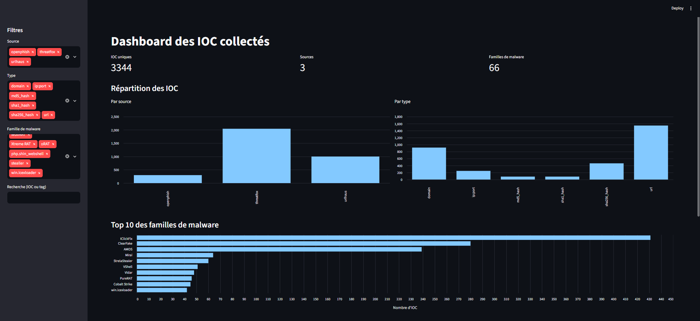
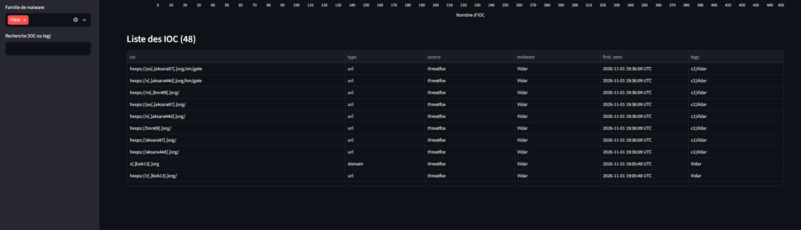

# J05 - Dashboard des IOC

> Défi CTI - jour 5/25 - 30/10/2026 - Python, Streamlit, visualisation

Un dashboard web qui affiche les IOC collectés par l'agrégateur de J01 : chiffres clés, répartition par source et par type, top des familles de malware, et un tableau filtrable. Il rend la collecte quotidienne lisible en quelques secondes. Dès sa première utilisation, il a permis de repérer de nouveaux domaines de C2 Vidar liés à l'infrastructure étudiée en J02 et J03.



## Fonctionnalités

| Élément | Détail |
|---|---|
| Chiffres clés | nombre d'IOC uniques, de sources et de familles de malware |
| Répartition | graphiques par source (OpenPhish, URLhaus, ThreatFox) et par type d'IOC |
| Top 10 | familles de malware les plus représentées, triées par nombre d'IOC |
| Filtres | par source, par type, par famille, et recherche dans les IOC et les tags |
| Tableau | liste des IOC filtrés, triable par colonne |
| Sécurité | les IOC sont affichés defangés (`hxxps://`, `[.]`) : aucun lien n'est cliquable |

## Résultat du 01/11/2026

- 3344 IOC uniques, 66 familles de malware identifiées.
- ThreatFox fournit la majorité des IOC, devant URLhaus et OpenPhish.
- Top des familles : IClickFix, ClearFake et AMOS loin devant, puis Mirai, StrelaStealer, VShell, Vidar, PureRAT, Cobalt Strike et IceXLoader.
- IClickFix et ClearFake dominent : deux familles liées aux faux messages qui poussent la victime à exécuter elle-même une commande ou à télécharger une fausse mise à jour.

## Cas d'usage : de nouveaux domaines Vidar



En filtrant le tableau sur Vidar, 48 IOC apparaissent. Les domaines de C2 de J02 (agenpr, agng11...) ont disparu, remplacés par de nouveaux domaines au même profil :

| Domaine | Serveurs DNS |
|---|---|
| aksara87[.]org | brady + princess (Cloudflare) |
| aksara44d[.]org | brady + princess (Cloudflare) |
| bnn69[.]org | brady + princess (Cloudflare) |
| bok13[.]org | brady + princess (Cloudflare) |

Mêmes serveurs DNS Cloudflare que les 6 domaines de J02, même forme de nom (nom court suivi de chiffres, en `.org`), sous-domaines d'une ou deux lettres, chemin `/gate`, rôle de C2 Vidar sur ThreatFox. Hypothèse, avec une confiance moyenne : l'opérateur identifié en J03 a renouvelé ses domaines. Une paire de serveurs DNS Cloudflare pouvant être partagée par plusieurs comptes, la confirmation demanderait de vérifier le registrar et les certificats, comme en J02.

```bash
for d in aksara87.org aksara44d.org bnn69.org bok13.org; do
  echo "== $d"
  dig +short NS "$d"
done
```

## Démarche

1. Lecture de `data/iocs.csv` (produit par J01) avec pandas.
2. Calcul des chiffres et des répartitions avec `value_counts()`.
3. Exclusion des étiquettes non informatives de ThreatFox (`Unknown malware`, `Unknown Loader`) dans le décompte des familles.
4. Graphiques avec Streamlit et Altair (tri décroissant du top 10).
5. Filtres combinés et recherche textuelle sur le tableau.
6. Defang des IOC à l'affichage, sur une copie des données.

## Lancer le projet

```bash
# depuis la racine du repo, venv activé
pip install -r requirements.txt
python J01-agregateur-ioc/main.py          # collecte du jour
streamlit run J05-dashboard-ioc/app.py     # puis ouvrir http://localhost:8501
```

## Limites

- Le dashboard affiche une collecte à un instant donné : pas d'historique ni d'évolution dans le temps.
- Les chiffres et graphiques du haut portent sur toute la collecte, seuls les tableaux sont filtrés.
- Il tourne en local : il n'est pas publié en ligne, car les données contiennent des IOC actifs.
- Les limites de J01 s'appliquent (flux gratuits partiels, colonne `malware` vide pour URLhaus et OpenPhish).

## Pistes

- Garder un historique des collectes pour afficher l'évolution jour après jour.
- Ajouter l'enrichissement de J06 (réputation VirusTotal, ASN, pays) dans le tableau.
- Filtrer aussi les graphiques selon les filtres choisis.
- Vérifier le registrar et les certificats des nouveaux domaines Vidar pour confirmer le lien avec l'opérateur de J03.
