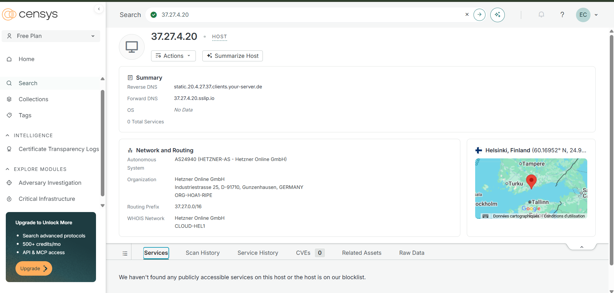
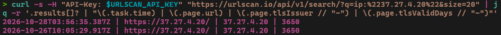

# J06 - Contourner Cloudflare : à la recherche des serveurs d'origine de l'opérateur Vidar

> Défi CTI - jour 6/25 - 03/11/2026 - Investigation infra, DNS passif, certificats

En J02 et J03, l'opérateur Vidar étudié cachait ses domaines de C2 derrière Cloudflare. Cette enquête teste les techniques classiques pour retrouver les serveurs d'origine derrière ce type de protection : enregistrements DNS oubliés, sous-domaines non protégés, historique DNS et pivot sur le certificat TLS du seul serveur exposé connu. Résultat : l'infrastructure en domaines est verrouillée, mais l'enquête révèle le cycle de vie des domaines et serveurs de l'opérateur, et une signature de détection propre aux serveurs Vidar 2.

> Piste suggérée par un professionnel de la CTI après la lecture de J03. Investigation passive uniquement : aucun serveur n'a été contacté directement, seules des sources publiques ont été interrogées. Les IOC sont defangés.

## Point de départ

| Élément | Détail |
|---|---|
| Question | peut-on retrouver les vrais serveurs de l'opérateur derrière Cloudflare ? |
| Domaines étudiés | les 6 domaines de J02 et les 4 nouveaux domaines repérés en J05 |
| Serveur exposé connu | 37.27.4[.]20 (Hetzner, J03) |
| Outils | dig, whois, RDAP, API VirusTotal (passive DNS), Censys, Shodan, API urlscan, API ThreatFox |

| Domaine | Origine |
|---|---|
| ayu99[.]pro, agia4d[.]org, agitawin[.]org, agng11[.]org, agenpr[.]org, bala7[.]org | J02 |
| aksara87[.]org, aksara44d[.]org, bnn69[.]org, bok13[.]org | J05 |

## 1. Enregistrements mail (MX et TXT)

Cloudflare ne cache que le trafic web. Les enregistrements MX (serveur de mail) et TXT (souvent le SPF, qui liste les IP autorisées à envoyer des mails) ne passent pas par son proxy et trahissent parfois le vrai serveur.

```bash
for d in agitawin.org agia4d.org agenpr.org agng11.org bala7.org ayu99.pro aksara87.org aksara44d.org bnn69.org bok13.org; do
  echo "== $d"
  echo "MX :"; dig +short MX "$d"
  echo "TXT :"; dig +short TXT "$d"
done
```

**Résultat :** aucun enregistrement MX ni TXT sur les 10 domaines. L'opérateur ne configure que le strict nécessaire : aucune trace de serveur mail.

## 2. Sous-domaines oubliés

Les opérateurs oublient souvent de protéger certains sous-domaines (`mail.`, `cpanel.`, `direct.`, `origin.`...), qui pointent alors directement vers le serveur d'origine.

Test préalable avec un sous-domaine inventé :

```bash
dig +short A nexistepas12345.agenpr.org     # 104.21.63.75, 172.67.170.69
dig +short A nexistepas12345.aksara87.org   # 188.114.97.2, 188.114.96.2
```

Un sous-domaine inexistant répond : le **DNS est en wildcard**. Combiné aux certificats wildcard vus en J02, il permet à l'opérateur d'utiliser n'importe quel sous-domaine aléatoire comme C2, sans aucune configuration.

Sous-domaines classiques testés sur agenpr[.]org, aksara87[.]org et bnn69[.]org : `www`, `mail`, `cpanel`, `ftp`, `dev`, `api`, `admin`, `panel`, `direct`, `origin`.

**Résultat :** les 30 sous-domaines répondent avec des IP Cloudflare (104.21.x.x, 172.67.x.x, 188.114.96-97.x). Aucun n'a été configuré à part : tout passe par le proxy.

## 3. Historique DNS

Si un domaine a pointé un jour vers son vrai serveur avant d'être placé derrière Cloudflare, les bases de passive DNS l'ont peut-être enregistré.

```bash
for d in ayu99.pro agia4d.org agitawin.org agng11.org agenpr.org bala7.org aksara87.org aksara44d.org bnn69.org bok13.org; do
  echo "== $d"
  curl -s -H "x-apikey: $VT_API_KEY" "https://www.virustotal.com/api/v3/domains/$d/resolutions?limit=40" | jq -r '.data[]?.attributes | "\(.date | strftime("%Y-%m-%d")) \(.ip_address)"' | sort -u
  sleep 16
done
```

| Domaine | Première résolution observée | IP |
|---|---|---|
| ayu99[.]pro | 02/11/2024 | Cloudflare, puis hors Cloudflare le 02/11/2026 (voir ci-dessous) |
| bnn69[.]org | 28/03/2025 | Cloudflare uniquement |
| agia4d[.]org | 08/01/2026 | Cloudflare uniquement |
| agitawin[.]org | 27/02/2026 | Cloudflare uniquement |
| aksara87[.]org | 29/04/2026 | Cloudflare uniquement |
| aksara44d[.]org | 29/04/2026 | Cloudflare uniquement |
| agng11[.]org | 02/05/2026 | Cloudflare uniquement |
| bok13[.]org | 05/05/2026 | Cloudflare uniquement |
| agenpr[.]org | 13/05/2026 | Cloudflare uniquement |
| bala7[.]org | 18/05/2026 | Cloudflare uniquement |

**Résultat :** 9 domaines sur 10 n'ont jamais été observés ailleurs que derrière Cloudflare, dès leur première résolution. C'est cohérent avec J02, où chaque domaine recevait son certificat le jour même de sa création : l'opérateur les branche sur Cloudflare immédiatement.

Les « nouveaux » domaines repérés en J05 existent en réalité depuis des mois (mars 2025 pour bnn69[.]org, fin avril 2026 pour aksara87[.]org et aksara44d[.]org) : l'opérateur prépare ses domaines à l'avance et les met en service plus tard.

### Le cas ayu99[.]pro : un domaine abandonné

Le 02/11/2026, ayu99[.]pro résout vers deux IP hors Cloudflare. Vérification :

| Indice | Valeur | Interprétation |
|---|---|---|
| Serveurs DNS | ns1/ns2.lander.d.parity[.]domains | le domaine a quitté le compte Cloudflare de l'opérateur |
| IP 104.219.250[.]37 | Namecheap (Web-hosting.com) | infrastructure du registrar |
| IP 2.59.170[.]20 | WorldStream (Pays-Bas) | hébergement de la page de parking |
| RDAP | statut `auto renew period`, modifié le 01/11/2026 à 14:14 UTC | expiré le 01/11/2026 à 14:03 UTC, en période de grâce |

Ces IP ne sont pas celles de l'opérateur : il n'a pas renouvelé son plus ancien domaine, et le registrar l'a basculé vers une page de parking onze minutes après son expiration. ayu99[.]pro n'est plus un C2 actif et ne doit plus être bloqué comme tel.

## 4. Le serveur exposé : 37.27.4[.]20



Le seul serveur de l'opérateur connu hors Cloudflare est l'IP contactée directement par XenoUI v7.55 dans ANY.RUN (J03).

| Source | Observation |
|---|---|
| Censys (03/11/2026) | Hetzner Cloud, Helsinki, reverse DNS par défaut de Hetzner, **aucun service exposé** |
| Shodan | aucune donnée |
| urlscan, 26/10/2026 10:05 UTC | HTTPS actif, certificat émis par « 37.27.4.20 », valable 3650 jours |
| urlscan, 28/10/2026 03:56 UTC | même certificat, serveur toujours actif |



- Le certificat est **auto-signé** : son émetteur est l'IP elle-même, et il est valable **10 ans**. C'est la cause de l'alerte « TLS cert too long-lived » vue dans ANY.RUN.
- Le serveur répondait encore le 28/10 et n'expose plus rien le 03/11 : il a été éteint quelques jours après son signalement sur ThreatFox (26/10).
- **L'IP a été recyclée.** Entre avril et juin 2026, urlscan montre la même adresse utilisée par l'environnement de développement d'une entreprise sans lien avec l'activité malveillante, avec de vrais certificats Let's Encrypt. Hetzner réattribue les IP de ses serveurs cloud : une IP n'appartient jamais durablement à un attaquant, et un IOC de ce type doit toujours être daté.

## 5. Le certificat de 10 ans : une signature Vidar ?

Si le certificat est fabriqué de la même façon sur d'autres serveurs, il peut servir à les retrouver. Test sur les C2 Vidar en IP récemment signalés sur ThreatFox :

```bash
curl -s -X POST https://threatfox-api.abuse.ch/api/v1/ -H "Auth-Key: $ABUSECH_API_KEY" -d '{"query":"malwareinfo","malware":"win.vidar","limit":300}' | jq -r '.data[]? | select(.ioc_type == "ip:port") | .ioc' | cut -d: -f1 | sort -u > /tmp/vidar_ips.txt

while read ip; do
  r=$(curl -s -H "API-Key: $URLSCAN_API_KEY" "https://urlscan.io/api/v1/search/?q=ip:%22$ip%22&size=5" | jq -r '[.results[]? | select(.page.tlsIssuer == "'"$ip"'") | .page.tlsValidDays] | first // "-"')
  echo "$ip | certificat auto-signé : $r jours"
  sleep 2
done < /tmp/vidar_ips.txt
```

| C2 Vidar | Certificat auto-signé au nom de l'IP |
|---|---|
| 37.27.4[.]20 (J03) | 3650 jours |
| 172.104.203[.]148 | 3650 jours |
| 37.27.22[.]195 | 3650 jours |
| 46.62.166[.]138 | 3650 jours |
| 15 autres IP | aucun scan urlscan disponible |

**Résultat :** tous les C2 Vidar pour lesquels urlscan dispose d'un certificat auto-signé présentent le même motif : émetteur égal à l'IP, validité de 10 ans. Ce motif est probablement généré par le serveur Vidar 2 lui-même : c'est une **signature de la famille**, pas de l'opérateur. Ces IP ne sont donc pas attribuées à l'opérateur de J03.

La majorité des 19 C2 Vidar sont hébergés chez Hetzner (plages 37.27, 65.21, 65.108, 95.216, 157.180, 159.69, 46.62, 77.42), comme 37.27.4[.]20.

**Signature de chasse proposée :** serveur HTTPS sur une IP directe, certificat auto-signé dont l'émetteur est l'IP, validité de 3650 jours, requêtes `POST /gate`.

## Synthèse

| Piste | Résultat |
|---|---|
| Enregistrements MX et TXT | aucun : infrastructure minimaliste |
| Sous-domaines | DNS wildcard, tout derrière Cloudflare |
| Historique DNS | Cloudflare dès le premier jour pour 9 domaines ; ayu99[.]pro abandonné et passé en parking le 01/11 |
| Serveur exposé 37.27.4[.]20 | certificat auto-signé de 10 ans, actif jusqu'au 28/10, éteint depuis, IP recyclée |
| Pivot sur le certificat | même motif sur 3 autres C2 Vidar : signature de la famille |

L'opérateur maîtrise son infrastructure en domaines : aucun serveur d'origine n'a fui. Il fait tourner ses domaines, en prépare d'autres des mois à l'avance, laisse expirer les anciens, et change aussi de serveur après signalement.

## Niveau de confiance

| Affirmation | Confiance | Pourquoi |
|---|---|---|
| Aucun serveur d'origine n'est exposé via DNS pour ces 10 domaines | Élevée | MX, TXT, sous-domaines et historique tous négatifs |
| ayu99[.]pro a été abandonné par l'opérateur | Élevée | expiration, serveurs DNS de parking, IP du registrar |
| 37.27.4[.]20 a été éteint entre le 28/10 et le 03/11 | Moyenne à élevée | actif sur urlscan le 28/10, aucun service sur Censys le 03/11 |
| Le certificat auto-signé de 10 ans est une signature de Vidar 2 | Moyenne | 4 C2 sur 4 observables, mais échantillon réduit |
| Les 3 autres C2 au même certificat appartiennent à d'autres clients de Vidar | Faible | déduit du caractère générique du motif, non vérifié |

## Limites

- L'historique DNS ne couvre que ce que VirusTotal a observé : une IP d'origine brève a pu lui échapper.
- L'historique Censys est réservé aux comptes payants.
- Le pivot sur le certificat dépend des scans urlscan existants : 15 C2 sur 19 n'en avaient aucun.
- Seules des sources publiques et passives ont été utilisées : aucun serveur n'a été sondé directement.

## Pistes

- Surveiller la mise en service de nouveaux domaines au même profil (Namecheap, serveurs DNS brady et princess, DNS et certificat wildcard).
- Utiliser la signature du certificat de 10 ans pour chasser de nouveaux C2 Vidar (J12, chasse aux C2).
- Vérifier le registrar et les certificats des domaines de J05 pour confirmer leur rattachement à l'opérateur.

## Sources

- [VirusTotal](https://www.virustotal.com)
- [Censys](https://search.censys.io)
- [Shodan](https://www.shodan.io)
- [urlscan.io](https://urlscan.io)
- [ThreatFox](https://threatfox.abuse.ch)
- [RDAP](https://rdap.org)
